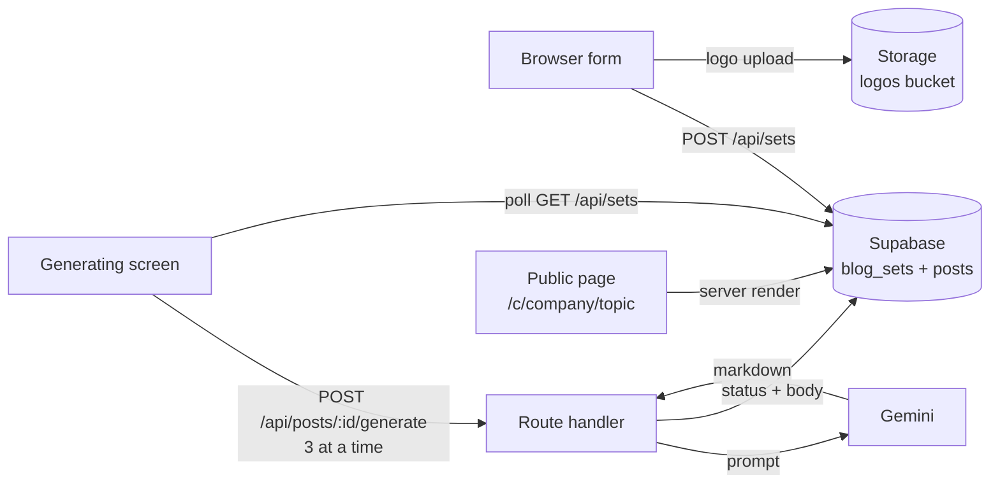

# Postwright

**Branded blog pages for any company, from a company name and a list of topics.**

Enter a company name, logo, brand colour and up to 10 topics. Postwright writes a ~1,000-word article per topic with Gemini and publishes each one as a public, branded page at `/c/<company>/<topic>`. It is multi-tenant: every company gets its own colour, logo and set of pages.

|                |                                                                                             |
| -------------- | ------------------------------------------------------------------------------------------- |
| **Live app**   | `<add Vercel URL>`                                                                          |
| **Demo video** | `<add video link>`                                                                          |
| **Stack**      | Next.js 14 (App Router), TypeScript, Tailwind, Supabase (Postgres + Storage), Google Gemini |

---

## What it does

- **Create a blog set** with a company name, optional logo (PNG, JPG, SVG, up to 2 MB), a brand colour and 1 to 10 topics.
- **Live preview** of the brand colour and layout while you fill in the form.
- **Generation screen** that shows per-topic status (Writing, Done, Failed) with one-click retry for any failed topic.
- **Public pages** at `/c/<company>/<topic>`, themed with the company's colour and logo, with a "More from <company>" list linking to the rest of the set.
- **Works for many companies** on one deployment. Nothing is hardcoded to a single brand.

## How it works



1. The form sends the company, colour and topics to `/api/sets`, which creates one `blog_sets` row and one `posts` row per topic (status `pending`).
2. The generating screen calls `/api/posts/:id/generate` for each post, **three at a time**, and polls for status.
3. Each generate call marks the post `writing`, asks Gemini for the article, then stores the Markdown body and word count and marks it `done` (or `failed`).
4. Public pages are server-rendered straight from the database, so a published page needs no client-side fetching.

## Design decisions

**One request per post, not one request for the whole set.**
A single call that writes 10 articles would exceed serverless time limits and fail as a unit. One post per request keeps each call short, lets failures be isolated and retried individually, and gives the UI real per-topic progress.

**Bounded concurrency (3).**
Parallel enough to finish a 10-topic set quickly, low enough to stay under Gemini's per-minute limits.

**Retry with backoff, then fail visibly.**
The generate route retries up to three times with a short wait, stops early if it is running out of the platform time limit, and logs the real upstream error. A topic that still fails is marked `failed` and can be retried from the UI. Failures are never silent.

**Length check.**
The prompt asks for about 1,000 words. If the first result comes back under 900 words, the route asks once more with a stricter instruction and keeps the longer version. Anything under 300 words is rejected as a failure.

**Constrained output format.**
The prompt fixes the structure (intro, four `##` sections, one bulleted list, a closing "The short version" section) and forbids invented statistics, awards, prices or claims about the company. A small line-by-line Markdown renderer turns that into HTML, so the model's output never has to be trusted as raw HTML.

**Server-only secrets, uncached reads.**
The Supabase service-role key and the Gemini key are only ever used in route handlers and server components. The Supabase client is configured not to cache, so freshly published pages are visible immediately.

**Model is configuration, not code.**
The Gemini model is read from `GEMINI_MODEL`. Provider model availability changes (the previous default stopped being available to new projects during development), and swapping it is an environment change, not a deploy of new code.

## Getting started

**Prerequisites:** Node 18+, a Supabase project, a Gemini API key.

```bash
git clone https://github.com/SufyTech/postwright.git
cd postwright
npm install
```

Create `.env.local`:

```bash
SUPABASE_URL=https://<your-project>.supabase.co
SUPABASE_SERVICE_ROLE_KEY=<server-only secret key>
GEMINI_API_KEY=<your key>
GEMINI_MODEL=gemini-3.8-flash
```

In Supabase, create the `blog_sets` and `posts` tables and a **public** storage bucket named `logos`, then run:

```bash
npm run dev
```

Open <http://localhost:3000>.

> Never commit `.env.local`. The service-role key bypasses row-level security and must stay on the server.

## Deploying to Vercel

1. Push the repo to GitHub and import it in Vercel.
2. Add the four environment variables above.
3. Deploy.

The generate route sets `maxDuration = 60`. Check your plan's limit: a post that needs a length retry makes two Gemini calls and can approach it.

## Project structure

```
app/
  page.tsx                          Home, list of blog sets
  new/page.tsx                      Create form with live preview
  sets/[id]/generating/page.tsx     Per-topic progress and retry
  sets/[id]/page.tsx                Set overview
  c/[company]/[post]/page.tsx       Public branded article page
  api/sets/                         Create and list sets
  api/posts/[id]/generate/route.ts  Writes one post
components/Markdown.tsx             Markdown to HTML renderer
lib/server/db.ts                    Supabase client (server only, uncached)
lib/server/gemini.ts                Prompt, Gemini call, length check
lib/util.ts                         Word count and helpers
```

## Known limits

- **Free-tier rate limits.** Gemini's free tier caps requests per minute and per day. A full 10-topic set can hit it, which is exactly what the retry and the per-topic "Try again" are for. Enabling billing on the key removes the constraint.
- **Generation runs from the browser.** The generating screen drives the work, so closing the tab mid-run pauses it. Pending and failed posts can be resumed from the set page.

## What I would build next

- Move generation to a background queue so it survives closed tabs and scales past a handful of concurrent users.
- Add authentication and per-user ownership of blog sets.
- Let users edit and re-publish individual posts, with version history.
- Add SEO metadata, sitemap and Open Graph images per page.
- Add tests around the Markdown renderer and the retry and length logic.

## Author

**Sufiyan Khan**, AI engineer · [GitHub](https://github.com/SufyTech)
